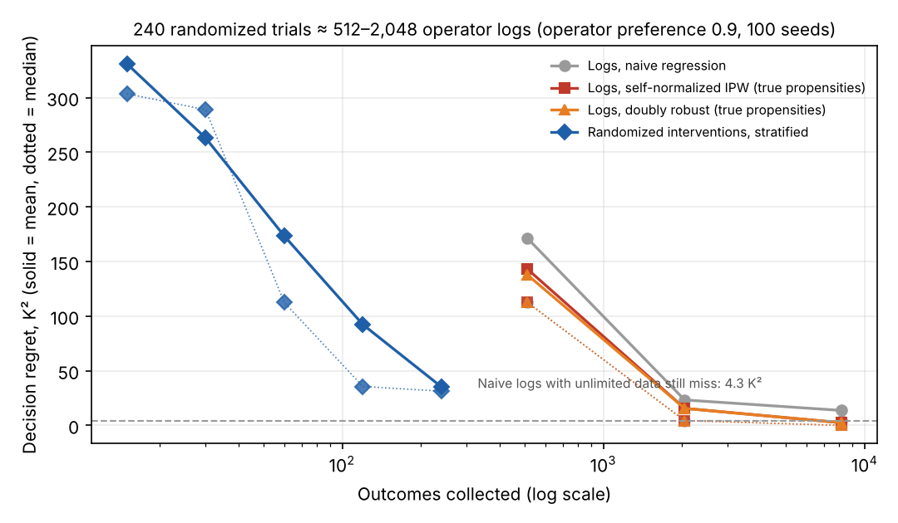

# Logs versus experiments: 100-seed results (v2)

19 October 2026. Protocol fixed before the run: `research/EXCHANGE_RATE_PROTOCOL.md`. Script: `research/process/run_exchange_rate.py`. Tables: `results/exchange_rate_v2/tables.md`. Every per-seed value is in `results/exchange_rate_v2/per_seed.json`. This follows an independent review (`review/INDEPENDENT_REVIEW.md`) and is exploratory: the task was chosen after earlier results were seen. CPU only.

## Headline

**At equal count, 240 randomized trials gave 7.6× lower decision regret than 240 operator-logged episodes: 27 vs 206 K², mean over 100 seeds.** Matching 240 trials took between 512 and 2,048 logged episodes. Logs analysed naively never fully recover: with unlimited data they converge to the wrong command in one of five concentration strata, a permanent 4.3 K² regret. Reweighting by the operator's action probabilities removes that floor, but only with thousands of logs. It also needs probabilities that depend on what the operator saw, which a plant log does not record.

## Part A: logged data versus randomized interventions (squared cost, operator preference 0.9)

| Data | Outcomes | Estimator | Mean regret, K² | Seeds with regret > 5 K² |
| --- | ---: | --- | ---: | ---: |
| Operator logs | 512 | naive regression | 171.2 | 97% |
| Operator logs | 512 | self-normalized IPW (true propensities) | 143.0 | 92% |
| Operator logs | 2,048 | naive regression | 23.3 | 49% |
| Operator logs | 2,048 | self-normalized IPW (true propensities) | 15.6 | 35% |
| Operator logs | 8,192 | naive regression | 13.6 | 31% |
| Operator logs | 8,192 | self-normalized IPW (true propensities) | 2.4 | 4% |
| Operator logs | unlimited | naive regression (exact limit) | 4.3 | — |
| Randomized, stratified | 120 | cell means | 92.3 | 80% |
| Randomized, stratified | 240 | cell means | 35.2 | 55% |

IPW, self-normalized IPW and doubly robust estimates are within about 1 K² of each other at 2,048 and 8,192 logs; see the tables file. With a milder operator (preference 0.6), naive regression has no asymptotic bias here and 2,048 logs reach 3.4 K². Confounding strength, not just log volume, decides how much the logs can be trusted.

**What limits small samples is variance, not only bias.** Costly thermal-runaway outcomes sit in rarely chosen commands: at the highest concentration, the 302 K command averages 1,577 K², against 101 K² for the best command. Even 240 randomized trials leave about half the seeds above 5 K² regret. Any plant pilot sized from this needs its own outcome-variance estimate.

## Part B: which way to spend 240 trial outcomes (100 seeds)

| Method at 240 outcomes | Mean regret, K² | Seeds > 5 K² | Difference vs stratified [95% CI] |
| --- | ---: | ---: | --- |
| Top-two Thompson sampling | 24.5 | 39% | −2.7 [−12.8, +8.2] |
| Stratified (equal per cell) | 27.1 | 48% | — |
| Random cells | 34.0 | 55% | +6.9 [−5.8, +20.4] |
| Decision-focused heuristic | 34.5 | 56% | +7.4 [−4.8, +21.3] |
| Uncertainty heuristic | 46.9 | 61% | +19.8 [+4.8, +36.0] |
| Operator-logged episodes | 206.0 | 92% | +178.9 [+147.4, +211.4] |

**Correction to the 10-seed follow-up.** That run reported stratified sampling beating both heuristics at 240 outcomes. With 100 seeds, stratified, random, top-two Thompson sampling and the decision heuristic cannot be separated; every confidence interval includes zero. Only the uncertainty heuristic is reliably worse, and passive operator data is far worse. The defensible statement is: any reasonable randomized design beats operator logs by a wide margin; choosing among those designs matters much less here.

## Related addenda (same review)

- **Matched-information reference for the information audit** (`results/information_audit_v1_references.json`). The best command per concentration stratum has 37.7 K² excess over the full-state oracle. The snapshot MLP trained on operator logs (preference 0.9) had 73.5 K², so it was worse than a fixed rule.
- **Concentration-difference features** (`results/information_audit_v1_difference_control.json`). The run replays the frozen history setting exactly; all three seeds match the saved values to full precision. Giving the same MLP two successive concentration differences cuts excess cost from 55.6 to 11.9 K² (seeds 22.4, 10.9 and 2.3). The temperature sensor case scores 7.4 K². The learned model's earlier failure came mostly from not extracting the derivative, not from missing information.

## Boundaries

This is one simulated reactor with a constructed operator, five discrete contexts and a resettable simulator. Propensities are only known because we built the operator. 100 seeds measure the variability of this setting, not plant-to-plant variation. Nothing here measures factory value. The next experiment that would add the most is transfer to new simulated units with a misspecified physics prior and realistic sensing (temperature measured, concentration lagged), as proposed in the review.
