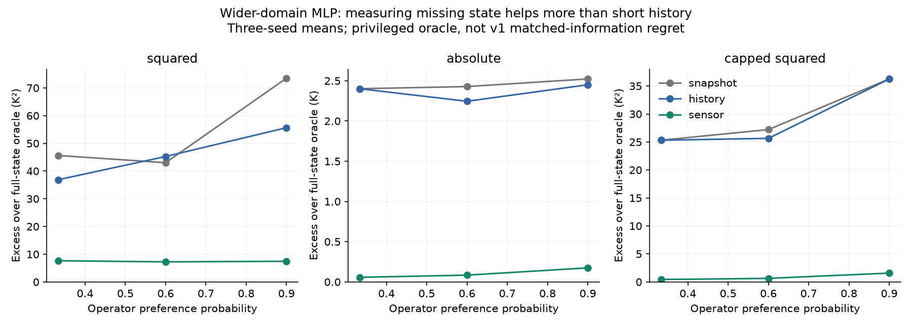
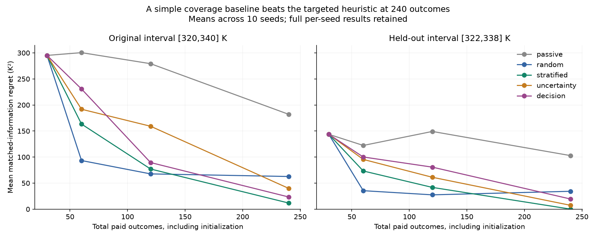

# Follow-up results: what survived, what failed, and what to do next

16 October 2026. These experiments were specified before their respective runs. They are follow-ups selected after seeing v1 results, not an independent external registration. No paid GPU was used.

## Decision

**Do not pitch our targeted acquisition heuristic as a research advance.** It lost to evenly distributed sampling at the largest tested budget in both temperature intervals. The defensible contribution today is a reproducible qualification study showing how conclusions change with information, operating region, objective, and collection design. That is useful evidence, but originality and factory value remain unproven.

## 1. Information and operating-region audit

108 models were fitted: two model families × three observation modes × three behavior probabilities × two initial-temperature intervals × three seeds. Each predicts squared, absolute, and capped-squared costs. Unlike v1, each episode has a short predecision warmup and histories end at the decision timestamp.

For the MLP in the wider interval, mean excess squared cost over a full-state oracle is:

| Operator preference | Current concentration | Three concentration readings | Current concentration + temperature |
| --- | ---: | ---: | ---: |
| 1/3 (random) | 45.62 | 36.88 | 7.64 |
| 0.6 | 43.02 | 45.25 | 7.23 |
| 0.9 | 73.52 | 55.64 | 7.44 |

Units are K². These compare all models against the **same privileged full-state oracle**. They are not the matched-information regrets in v1. Measuring temperature strongly helps these fitted models. The short history helps inconsistently; this does not establish that histories cannot identify the state. In a noiseless deterministic two-state system, a suitably designed estimator may extract much more from concentration changes than these generic models do. Current concentration after warmup also contains some information about initial temperature; it is not the independent snapshot construction of v1.

With operator preference 0.9, the wider-domain MLP absolute-cost excess is 2.52 K for snapshot, 2.45 K for history, and 0.17 K for sensor. Capped-squared excess is 36.25, 36.25, and 1.57 K² respectively. The information effect is therefore not restricted to unbounded squared cost, although its size and interpretation change with the objective.

**The narrower interval is a task-degeneracy control.** All 162 metric rows for that interval have zero decision excess. The 302 K command is optimal for all 1000 evaluated episodes under squared cost. Thus this interval does not demonstrate successful difficult causal reasoning; it shows that a task can become trivial when its operating range changes. Maximum evaluated temperature is 332.90 K in the narrower interval versus 507.72 K in the wider interval.

A meaningful next physical domain should combine nontrivial action tradeoffs and moderate temperatures, justified independently of the desired algorithm ranking. Do not tune a simulator until a preferred method wins.

## 2. Equal-budget collection comparison

Five methods share the same 30 initial interventional outcomes per seed. Every additional outcome is charged. Ten seeds, two intervals, four total budgets, three cost metrics, and all per-seed values are retained. Selection uses only acquired cost statistics. Hidden temperatures and evaluator answers are excluded from selector inputs.

Mean matched-information squared-cost regret at 240 total outcomes:

| Method | Original interval [320,340] | Held-out interval [322,338] |
| --- | ---: | ---: |
| Passive additions, naive pooling | 182.03 | 102.82 |
| Random interventions | 62.70 | 34.31 |
| Evenly distributed interventions | **11.74** | **0.09** |
| Predictive-uncertainty heuristic | 39.88 | 7.41 |
| Decision-focused heuristic | 23.37 | 19.51 |

At smaller budgets, rankings differ: random sampling is better than evenly distributed sampling at budgets 60 and 120 in both intervals. There is no uniform winner across every budget. The held-out interval is a new simulator distribution, not a new plant. These are descriptive ten-seed means, not evidence of a universal ordering or a calibrated risk guarantee.

The targeted heuristic receives no unpublished advantage from a free labeled starting set. Its assumptions still favor a simulator: it can choose/reset the concentration context, something a factory may not allow. The passive comparator mixes the initial intervention set with observational data and is deliberately a naive baseline, not a sophisticated causal estimator.

Prior work already studies [active sampling under causal confusion](https://proceedings.mlr.press/v213/gupta23a.html) and [adaptive best-arm identification](https://proceedings.mlr.press/v49/russo16.html). Our simple Gaussian score is not an implementation of those published algorithms and inherits none of their guarantees. The generic idea is not a novelty claim.

## 3. Exploratory check on real-robot uncertainty

Without retraining, we examined disagreement between the three command-conditioned MLPs at 100 ms. Within each held-out rollout, we ranked windows by disagreement, then compared that ranking with actual ensemble prediction error. This analysis uses already-inspected test predictions and is explicitly exploratory.

On GPs splits, median within-rollout Spearman correlations range from 0.129 to 0.308. On Sines transfer 2 and 3, they are -0.022 and -0.035. For Sines transfer 3, the top 20% of windows by model disagreement have only 0.848 times the overall MSE (median across nine rollouts). Uncertainty ranking therefore does not consistently identify the largest errors. No claim of calibrated confidence or causal diagnosis is warranted. Windows are correlated; we do not count them as independent experimental replicates.

## 4. Implication for the company proposal

The credible proposition is to qualify a small, specific decision before scaling model complexity: check record quality, information available to operators, execution fidelity, task nontriviality, and conventional collection baselines. A plant pilot must establish usefulness on actual micro-stop decisions. The business hypothesis is that this can reduce wasted labeling and integration effort; our experiments have not measured such savings.

Raising capital would require evidence beyond this project, including customer demand and delivery economics.

## Reproducibility

- Protocols: `research/FOLLOWUP_PROTOCOL.md` and `research/ACQUISITION_PROTOCOL.md`.
- Results: `results/information_audit_v1`, `results/acquisition_v1`, `results/robot_uncertainty_v1`.
- Frozen configurations and code hashes, evaluator outputs, acquisition ledgers, and per-seed metrics remain local.
- Scripts refuse to overwrite an existing configuration. Use a new version/output path for changed experiments.
- Acquisition ledgers contain 24,000 arm-accounted outcomes, including shared initialization copied into each arm's ledger. They are not 24,000 unique independent simulations. The evaluator's counterfactual trajectories are separate and never given to selectors.
