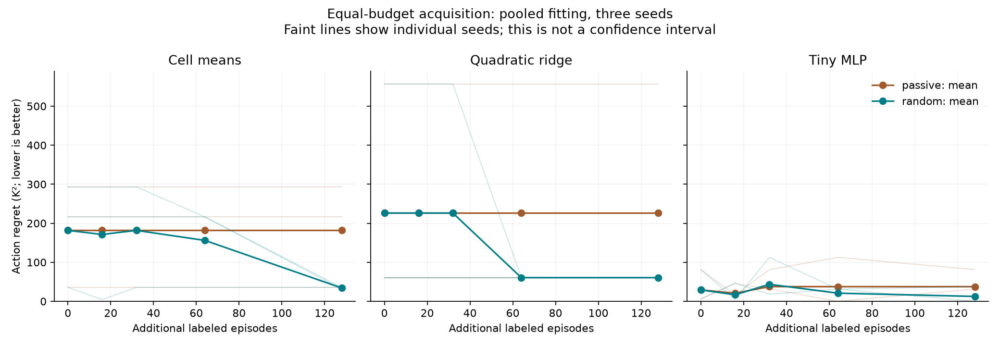
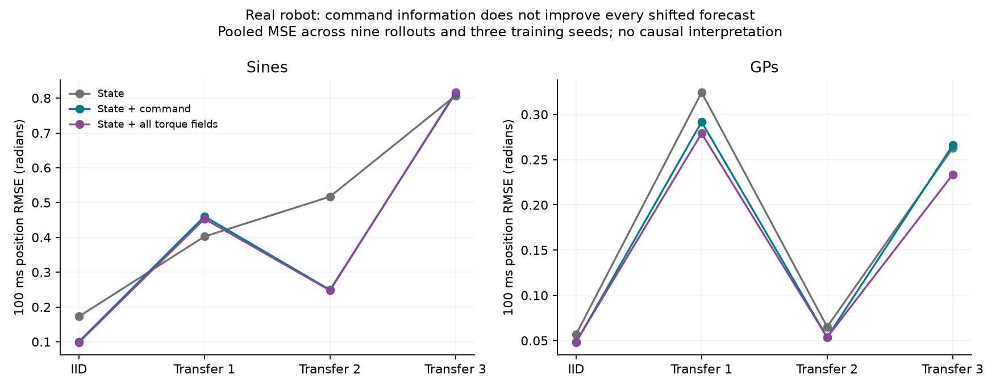

# First experimental results — 16 October 2026

**We have a reproducible research prototype, not yet a demonstrated breakthrough.** The controlled experiment shows that data collection policy can matter for intervention choices. The real dataset shows that richer action information can improve IID prediction while worsening a particular transferred forecast. These are separate findings; the second does not prove the mechanism in the first.

## 1. Controlled intervention study

The environment uses pinned PC-Gym CSTR equations. Initial concentration takes five values; initial temperature is uniform from 320–340 K. The snapshot learner sees concentration and the candidate coolant command. The logging operator sees temperature and chooses its preferred command with probability 0.9. The learner predicts ten future states and a direct integrated temperature-error cost. Recommendations minimize the predicted cost, not squared mean predicted temperature.

The evaluator averages actual cost over hidden temperature conditional on the learner's observed concentration. Thus the comparator has the same information as the snapshot learner. Three commands are available: 290, 296, and 302 K. The correct expected-cost choices across the five concentrations are **302, 296, 296, 296, 290 K**.

Every acquisition arm starts with the same 512 logged episodes. Passive and randomized additions share initial states, receive one outcome per command, and use nested budgets of 16, 32, 64, and 128 episodes. Full counterfactual outcomes belong only to the evaluator. Three seeds are reported, without treating timesteps as independent replicates.

Mean action regret at 128 additional episodes, in K² (lower is better):

| Predictor | Initial 512 | +128 passive, pooled | +128 random, pooled | Separate 512 random-source control |
| --- | ---: | ---: | ---: | ---: |
| Cell means | 181.69 | 181.69 | 34.17 | 1.45 |
| Quadratic ridge | 226.09 | 226.09 | 60.63 | 60.63 |
| Tiny MLP | 29.16 | 37.51 | 12.50 | 1.45 |

The separate random-source column replaces the initial data policy; it is not an acquisition result at the 128-label budget. Uniform random command selection has expected regret 218.38 K². Some fitted models are worse than that baseline.

**The seed variation is substantial.** MLP initial regrets are 81.24, 6.23, and 0.00 K². With 128 randomized additions they are 0.00, 37.51, and 0.00 K². Randomized acquisition therefore worsens one seed. The result supports further investigation, not a universal improvement claim. Quadratic ridge remains misspecified even with randomized source data. Full-state models have their own privileged-information oracle and must not be compared directly to snapshot regret.

Additional-data-only fitting is also saved, including its failures. At 128 passive labels the MLP selects poorly in all three seeds (557.00 K² regret each). With random labels its regrets are 0.00, 37.51, and 0.00 K². Sparse cells and rare, high-cost thermal excursions make estimates unstable. No acquisition method was selected or tuned after inspecting these outcomes.

### Post-run coverage audit

All 15 observed concentration/action cells are populated in every initial training seed (minimum 21 examples). Nevertheless, pooled mean initial temperatures conditional on coolant commands 290, 296, and 302 K are **335.57, 330.02, and 324.43 K**. In the 128 randomized additions they are **330.17, 329.97, and 330.14 K**. These are descriptive pooled means, not significance tests or evidence of exact finite-sample balance.

This demonstrates the intentionally constructed conditional-selection problem despite apparent observed-cell coverage. It does not exclude hidden-region sparsity, thermal-tail sensitivity, or model misspecification as contributors. The full cell-level counts and temperature ranges are in `results/process_v1/coverage_audit.json`.

## 2. Real-robot forecasting

Two excitation families, official training/validation splits, and four official test conditions were used. Each test condition has nine complete rollouts. Features are taken only at the forecast timestamp; no future commands or measured states are supplied. Models predict joint-position residuals beyond constant velocity at 10, 50, and 100 samples. The recorded sampling assumption maps these to milliseconds.

Selected 100 ms RMSE results in radians, aggregating equal-rollout MSE and three MLP training seeds:

| Family / split | MLP state | MLP + desired command | MLP + all torque fields |
| --- | ---: | ---: | ---: |
| Sines IID | 0.17264 | 0.10053 | 0.09813 |
| Sines transfer 1 | 0.40230 | 0.46036 | 0.45333 |
| Sines transfer 2 | 0.51692 | 0.24912 | 0.24736 |
| Sines transfer 3 | 0.80699 | 0.81415 | 0.81636 |
| GPs IID | 0.05695 | 0.04799 | 0.04857 |
| GPs transfer 1 | 0.32426 | 0.29169 | 0.27903 |
| GPs transfer 2 | 0.06521 | 0.05361 | 0.05353 |
| GPs transfer 3 | 0.26262 | 0.26585 | 0.23337 |

Commands help many forecasts. They do not help every transferred forecast. Extra execution-related fields are also not uniformly beneficial. These comparisons change information and input parameter counts; they are not an architecture-matched causal test. Persistence, constant velocity, and quadratic ridge results at every horizon remain in `results/real_robot_v1/summary.json`, including poor extrapolation by richer ridge models.

## 3. Numerical and experimental checks

- Adapter derivatives match the pinned upstream equations to maximum absolute error 2.84e-14 on 63 development cases.
- Coarse RK4 steps were invalid or inaccurate. At the selected step 0.000125, maximum temperature error against independent Radau trajectories is 0.000110 K on that grid. Halving the step reduces it further. This is finite-domain validation, not a global error bound.
- Hidden-temperature quadrature refined from 61 to 122, 244, and 488 midpoint nodes under a prespecified 1 K² mean-cost convergence threshold. The last refinement changes action means by at most 0.0904 K².
- Halving the cost integration output interval changes action means by at most 0.0198 K².
- Automated tests pass (12 in the current suite; four were described here when v1 was written): timestamp/rollout isolation; a stiff trajectory against an independent solver; private-temperature feature exclusion and reversed policy; explicit missing-cell fallback.
- Frozen configuration files include code hashes. Predictions and episode ledgers are retained. The process experiment has 168 evaluations; the real experiment has 3,024 per-rollout metric records.
- GPU credit spent: **$0**. All training and evaluation here used CPU.

## 4. What this does not establish

This is not a foundation world model, a new causal identification result, a packaging-cell replication, a deployment-ready controller, or evidence of factory transfer. Only three training seeds were used. The simulated behavior policy intentionally creates confounding; snapshot observations intentionally omit temperature. Thermal excursions strongly influence average squared-error cost. Five discrete concentration strata are shared between training and evaluation; this is not generalization to new plants or unseen concentrations. Rare-action counts and poor function approximation can also impair decisions.

The full-state control is not sufficient by itself to distinguish all these effects. We have not yet run realistic observation histories, sensor-noise sweeps, policy-strength sweeps, cost-tail sensitivity, or execution-delay interventions. Public robot data cannot supply counterfactual outcomes to resolve those questions.

## 5. Next decision

The most valuable next experiment is an **information and coverage audit**, not a larger network: extend the completed action-cell and conditional-temperature audit; compare matched histories or a temperature sensor; test whether randomized acquisition remains useful across policy strengths and less tail-sensitive costs. Freeze that follow-up before running it. Preserve the current v1 results as exploratory evidence when selecting a follow-up hypothesis.

A company-facing submission should follow this audit and independent review. Its defensible pitch is a reproducible method for checking whether predictive gains translate to useful decisions, with unusually explicit failure cases. Originality and hiring impact remain unproven.
