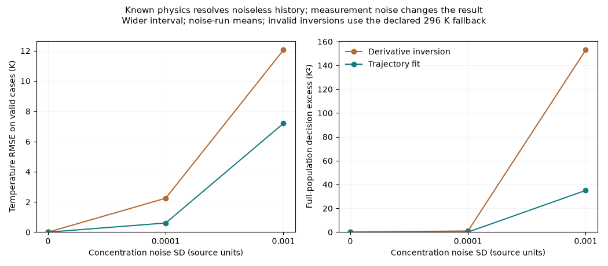

# State estimation: the history contains the missing information

16 October 2026. Mechanistic follow-up on previously examined evaluation episodes, with assumptions fixed in `research/STATE_ESTIMATION_PROTOCOL.md` before execution.

## Conclusion

**The history-model failure is not evidence that these noiseless histories lack temperature information.** Both known-physics estimators recover temperature and choose optimal actions on all 1000 episodes in each evaluated interval, for all three cost objectives, in the noiseless matched-parameter setting.

The three-point derivative estimate followed by algebraic inversion has temperature RMSE 0.000694 K on the wider interval. Fitting an initial temperature to the short concentration trajectory reduces that RMSE to approximately 3e-7 K. Neither receives the true temperature or future outcomes as an input. Both know the governing equations; the trajectory fit also knows the historical command and timing. This is additional physical knowledge unavailable to the generic learned models, not an architecture-matched victory.

## Wider-interval sensitivity results

Nonzero-noise rows average three independent noise realizations on the same 1000 physical episodes. Zero-noise rows are deterministic, not three independent replications. Temperature RMSE is conditional on usable estimates. Decision excess includes all episodes and the prospectively declared fixed-command fallback for invalid estimates.

| Noise SD | Assumed k0 / true k0 | Estimator | Temperature RMSE, K | Valid fraction | Boundary fraction | Decision excess, K² |
| --- | --- | --- | ---: | ---: | ---: | ---: |
| 0 | 1 | finite difference | 0.000693853 | 1.0000 | 0.0000 | 0.0000 |
| 0 | 1 | trajectory fit | 2.99826e-07 | 1.0000 | 0.0000 | 0.0000 |
| 0.0001 | 1 | finite difference | 2.2463 | 0.9997 | 0.0000 | 1.0238 |
| 0.0001 | 1 | trajectory fit | 0.607058 | 1.0000 | 0.0000 | 0.0833 |
| 0.001 | 1 | finite difference | 12.0498 | 0.7747 | 0.0000 | 152.9247 |
| 0.001 | 1 | trajectory fit | 7.19431 | 1.0000 | 0.0340 | 35.0632 |
| 0 | 0.9 | finite difference | 1.31644 | 1.0000 | 0.0000 | 1.0397 |
| 0 | 0.9 | trajectory fit | 1.27288 | 1.0000 | 0.0000 | 1.1425 |
| 0 | 1.1 | finite difference | 1.18292 | 1.0000 | 0.0000 | 0.7816 |
| 0 | 1.1 | trajectory fit | 1.14279 | 1.0000 | 0.0000 | 0.8100 |

The larger noise setting invalidates approximately 22.5% of derivative inversions in the wider interval. The trajectory fit always returns a finite bounded estimate, but 3.4% of solutions approach the search limits. **Finite is not the same as reliable.** A bounded solver can hide poor identifiability behind a plausible number; boundary hits and residuals deserve attention.

A ±10% error in the assumed kinetic pre-factor produces roughly 1.1–1.3 K temperature RMSE and nonzero decision error even with noiseless observations. These are sensitivity examples, not realistic factory parameter distributions. The same assumed parameters are used for estimation and subsequent forecasting.

## How the observer works

The concentration equation provides `k = ((q/V)(Caf-C) - dC/dt)/C`, then `T = (EA/R)/log(k0/k)`. The derivative uses only the three concentration samples ending at the decision. Invalid logarithms are reported as abstentions. Differentiation magnifies measurement noise.

The trajectory fit fixes initial concentration to its measured value and searches initial temperature over [300,360] K for the best fit to the next two historical concentration readings. It uses 36 golden-section iterations and the known 296 K warmup. This is a simple conditional least-squares observer, not a full statistical state estimator: initial-concentration uncertainty, correlated sensor error, and parameter uncertainty are not jointly inferred. Its boundary fraction is not a calibrated confidence score.

## Claims this removes

- Do not describe the history experiment as proving an irreducible hidden-state problem.
- Do not infer that adding a temperature sensor is always necessary from the MLP comparison.
- Do not claim learned world models are necessary when known physical equations already solve the tested noiseless problem.
- Do not describe these results as evidence of industrial sensing quality or factory ROI.

The original snapshot confounding construction remains valid in its stated information setting. The history experiment has different information, and its conclusions must be narrower.

## Practical implication

Before spending a collection budget or training a larger model, ask what state information is recoverable from existing measurements under available physical knowledge. Then measure sensitivity to noise, model mismatch, and incomplete execution records. A useful industrial contribution would combine these checks with an actual operational decision and quantify when the simplest adequate model stops being adequate.

This study still needs external methodological review and a real, nontrivial decision domain. An independent review was later completed; its technical findings are summarized in `review/INDEPENDENT_REVIEW.md`.

## Artifacts

The complete 108 metric rows, per-episode estimates, validity flags, boundary flags, action choices, frozen configuration, and source hashes are in `results/state_estimation_v1`. Reproduce in a fresh output version with `python -m research.process.run_state_estimation`. All numerical code uses the previously validated small integration step.
